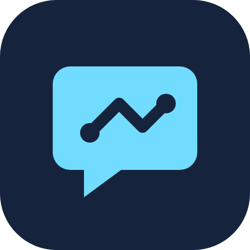

# LarkAgentD

Mention the assistant in a registered Lark group to recall a decision, read a shared document, or create a Doc, Sheet or Slides deck. It replies in the original thread. The dashboard manages group access, sources, models and usage.

## Run locally

1. Install Docker with Compose and run `make env`.
2. Edit `.env` locally. Set the Lark app credentials, dashboard admin email, Hermes provider and model, service keys, and a base64-encoded random 32-byte credential encryption key. Keep the encryption key with the database.
3. Run `make run`. Open <http://localhost:18080/dashboard> and send `/dashboard login` to the bot in a DM. Exchange the token, register a group, and mention the bot there.

Use `make status` to inspect services and `make stop` to stop the app. See the [deployment guide](docs/run.md) for permissions and acceptance checks, or [view the dashboard](docs/dashboard.md).

## Develop

Use a feature branch and open a pull request targeting `main`. Prefix commits and PR titles with `feat:`, `fix:`, `docs:`, `refactor:`, `test:`, or `chore:`.

[Contribution guide](CONTRIBUTING.md) · [Agent instructions](AGENTS.md) · [Architecture](docs/architecture.md) · [MIT license](LICENSE)
