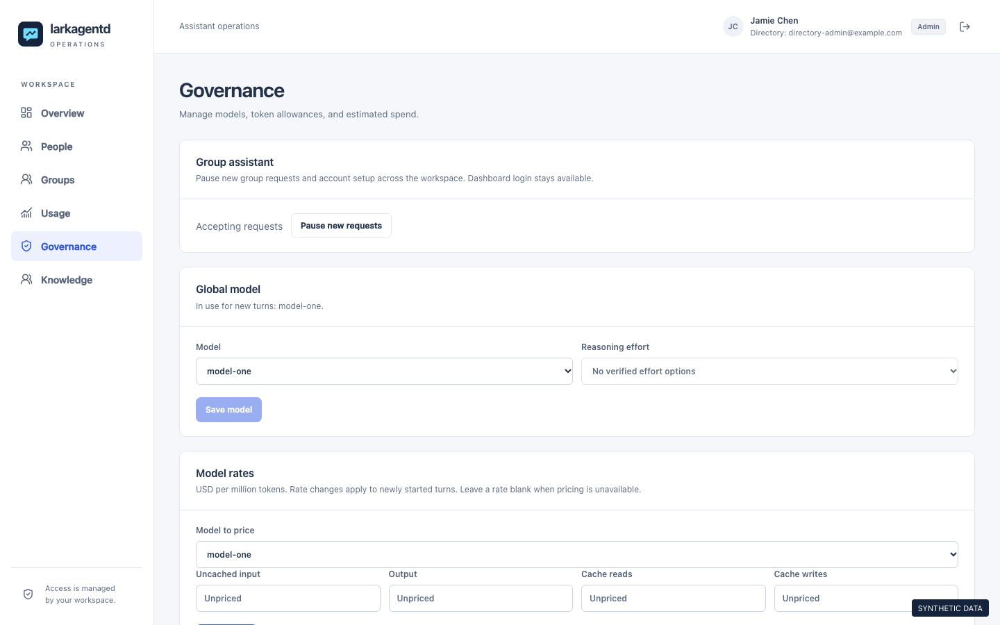

# Dashboard

These screenshots use synthetic data. They can be regenerated with
`npm --prefix frontend run build` and `npm --prefix frontend run screenshots`.

## Overview

Overview shows estimated spend, pricing coverage, active people and groups, token usage, and tool success for the selected period. Adoption counts distinct requesters and groups with recorded model sessions. Tool success uses finished calls. The daily bars cover the displayed dates. Spend by model ranks the three highest priced totals across the full filtered period and groups the rest under Other models. **Expand report** opens a recording view on supported browsers and keeps the data source visible.

When model sessions have no USD estimates, Overview shows recorded activity and links to model rates in Governance. Rate changes apply to new sessions. Use **Filters** to narrow the overview or **Reporting coverage** to inspect missing usage and scan estimates.

## Groups

## Group knowledge

Workspace admins can open **Knowledge > Add source** to attach a Lark Wiki or Doc for registered groups. Use **View sources for** to switch between the workspace and a registered group. Group admins can add sources on their own group dashboard. Paste a wiki space settings link to include the entire space, a wiki page link to include its branch, or a current or classic Doc link for one document. The preview shows which pages the source includes. Leave **Custom name** blank to follow the document, page or space title in Lark. Enter a name to keep your own label.

The Tool Service bot needs read access to the space and documents. It indexes supported pages on attachment and every 15 minutes. **Refresh now** requests an earlier sync. A partial sync retries and keeps the previous inventory until traversal completes. Search checks the receiving group's Lark access and the page version before quoting an excerpt. Removing a source drops its local index and leaves the Lark pages intact.

## Governance

