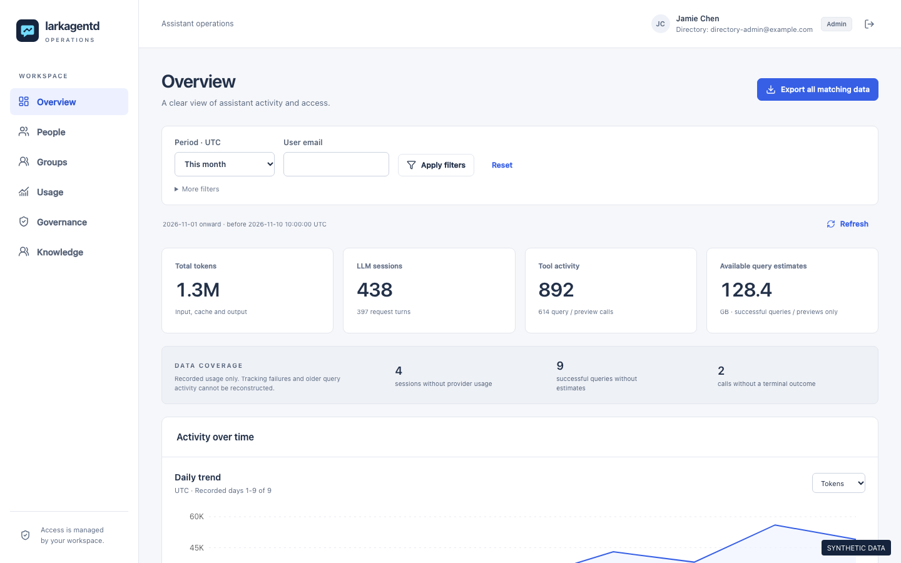
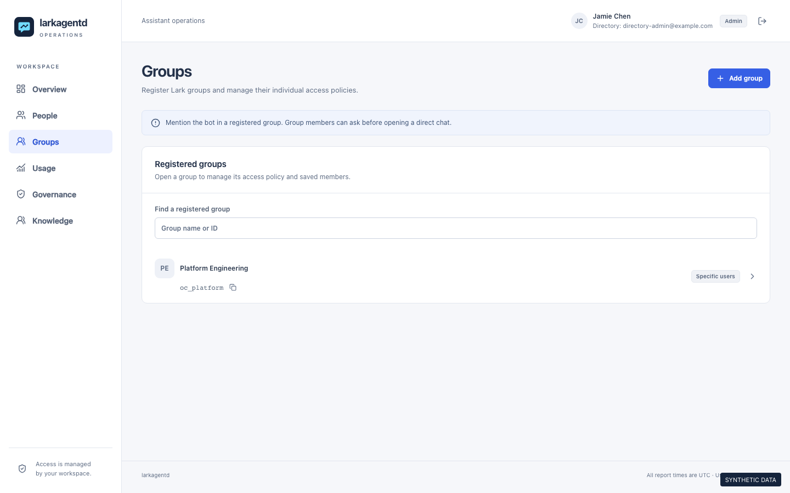
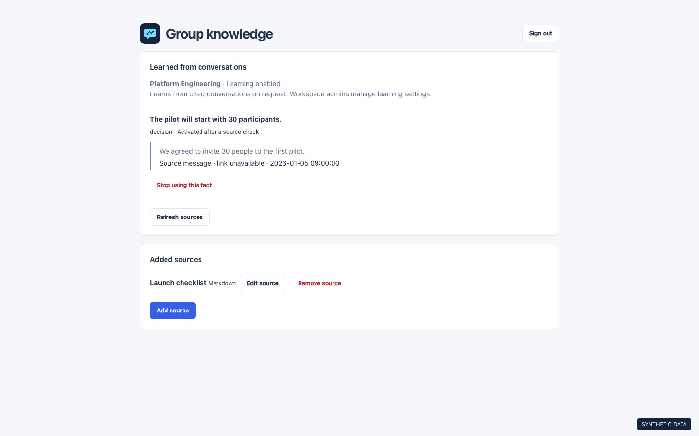

# Dashboard

These screenshots use synthetic data. They can be regenerated with
`npm --prefix frontend run build` and `npm --prefix frontend run screenshots`.

## Overview

## Groups

## Group knowledge

## Governance

